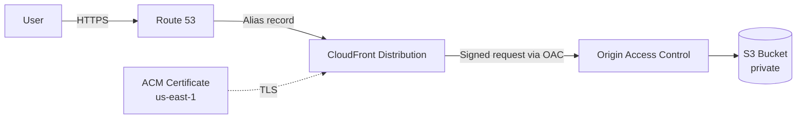

# AWS Professional Portfolio — Solution Architecture Case Study

> Live production site: **https://miltonquintana.com**

This repository documents a production-deployed professional landing page
as a Solution Architecture case study: the AWS infrastructure behind it, the
security model, the architectural decisions and trade-offs, and the
spec-driven workflow used to build and deploy it with [Kiro](https://kiro.dev).
This README is written for a technical reviewer evaluating architecture and
engineering practice, not as a React tutorial.

## Problem

Technical professionals (Solution Architects, Cloud Architects, Technical
Presales) need a credible, easy-to-share digital presence that communicates
experience, expertise and services clearly — without the overhead of a CMS,
a backend, or ongoing technical maintenance. This project is that presence
for its owner, built and deployed as a fully static site on AWS.

## Architecture

Route 53 resolves the domain to a CloudFront distribution, which terminates
TLS using an ACM certificate and is the only public entry point. CloudFront
reaches a fully private S3 bucket exclusively through Origin Access Control
(OAC), using signed requests — the bucket itself is unreachable from the
public internet. No backend, no database, no server to patch. Full detail
in [docs/architecture.md](./docs/architecture.md).

## Live URL

**https://miltonquintana.com**

## Stack

- **Frontend**: React, TypeScript, Vite, CSS Modules — content fully
  decoupled from components (`src/content/es.ts`)
- **Infrastructure**: S3 (private) + CloudFront + Origin Access Control +
  ACM + Route 53
- **Deployment**: manual, via AWS CLI, using a dedicated least-privilege
  IAM role (no Infrastructure as Code yet — a deliberate choice for this
  first deployment, see decisions below)

## Key Architectural Decisions

Twelve decisions are documented in full ADR format (context / decision /
alternative / trade-off) in
[docs/architecture-decisions.md](./docs/architecture-decisions.md),
including: private S3 vs. Static Website Hosting, CloudFront as the sole
public entry point, OAC vs. legacy OAI, Route 53 Alias records, ACM in
`us-east-1`, no WAF for this MVP, no backend, no database, no IaC for the
first deployment, no redirect function between apex and `www`,
differentiated Cache-Control, and a dedicated least-privilege IAM role for
deployment.

## Security

Private S3 bucket with Block Public Access on all four settings, a bucket
policy scoped to one specific CloudFront distribution via a `SourceArn`
condition, OAC with SigV4 signing, HTTPS enforced with TLS 1.2 minimum, a
least-privilege IAM deployment role with no self-escalation permissions,
WHOIS privacy and domain transfer lock enabled. No secrets anywhere in the
frontend bundle — there's nothing to authenticate against. Full detail in
[docs/security.md](./docs/security.md).

## Caching Strategy

Content-hashed assets (`assets/*.js`, `*.css`) get a one-year immutable
cache, since a new deploy always produces new filenames; `index.html` gets a
short cache with mandatory revalidation, since it's the file that references
those hashed assets. Full table and invalidation rules in
[docs/deployment.md](./docs/deployment.md).

## Estimated Cost

This is a low-traffic static site on CloudFront + S3 + Route 53 + ACM — on
AWS's on-demand pricing, this profile sits in the low-cost / Free-Tier-and-PAYG
range for CloudFront and S3, with Route 53 contributing a hosted zone fee and
the domain its annual registration cost (both effectively ~$22/year
prorated). ACM certificates are free. A full cost gate — unit prices,
Low/Expected/High usage scenarios, and major cost drivers — is required
before any production deployment decision and, where already produced, lives
in [`AWS_DEPLOYMENT.md`](./AWS_DEPLOYMENT.md); no new cost figures are
invented in this README.

## Built with Kiro

Built through Kiro's spec-driven workflow: Requirements → Design → Tasks →
Implementation → Verification → Deployment, with the project owner approving
every gate along the way (requirements, design, each implementation task,
and every step of the AWS deployment). Full explanation in
[docs/kiro-workflow.md](./docs/kiro-workflow.md).

## What this project demonstrates

- AWS Solution Architecture: a complete, production static-hosting pattern
  (Route 53 → CloudFront → OAC → private S3) reasoned about end to end, not
  copy-pasted.
- Cloud security judgment: least privilege, no public buckets, no legacy
  OAI, scoped bucket policies, and an explicit account for what was *not*
  built (WAF, backend) and why.
- Manual IaC-free infrastructure built with a genuine understanding of each
  resource and its connections, before any automation layer is added.
- Supervised, responsible use of AI coding agents in a real spec-driven
  delivery process — acceleration without ceding decision-making.
- A production React/TypeScript application: typed content model, component
  structure, responsive and accessible UI.

## Contact

- LinkedIn: https://www.linkedin.com/in/milton-quintana-arboleda-4108b2160/
- GitHub: https://github.com/mquintanaarboleda-gif

## Documentation

- [docs/architecture.md](./docs/architecture.md)
- [docs/architecture-decisions.md](./docs/architecture-decisions.md)
- [docs/security.md](./docs/security.md)
- [docs/deployment.md](./docs/deployment.md)
- [docs/kiro-workflow.md](./docs/kiro-workflow.md)
- [AWS_DEPLOYMENT.md](./AWS_DEPLOYMENT.md)
