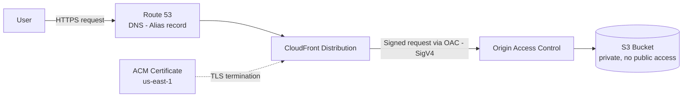

# Architecture

## Overview

The production architecture serves a fully static React/TypeScript single-page
application through a private origin, with a CDN as the only public entry
point. There is no backend, no database and no server-side runtime: every
request is either a static asset served from the edge or a redirect to HTTPS.

## Request flow

1. **User** resolves `https://miltonquintana.com` (and `www`) via DNS.
2. **Route 53** answers with an Alias record pointing at the CloudFront
   distribution (no CNAME is possible at the zone apex, which is why Alias is
   used instead of a plain CNAME).
3. **CloudFront** is the single public entry point. It terminates TLS using
   the certificate issued by **ACM** (must live in `us-east-1`, a hard
   requirement for any certificate CloudFront can attach to a distribution,
   independent of where the S3 bucket itself lives), enforces HTTPS-only
   access, and serves `index.html` as the default root object.
4. CloudFront reaches the origin through **Origin Access Control (OAC)**,
   which signs every origin request with SigV4. The bucket policy only trusts
   requests that carry this signature and originate from this specific
   distribution.
5. **S3** stores the build output (`dist/`) as a fully private bucket: Block
   Public Access is enabled on all four settings, and Static Website Hosting
   is never enabled. A direct request to the bucket's own endpoint returns
   `403 Access Denied`.

## Why no backend / no database / no WAF for this MVP

The landing page has no forms, no user accounts, and no dynamic data —
every page view renders the same static content for every visitor. Adding a
backend, an API layer or a database would introduce operational surface
(availability, scaling, patching, cost) with no corresponding requirement.
WAF is a defense against layer-7 attack patterns (bots, injection attempts,
scraping) that matter most when there's a backend or dynamic logic to
protect; for a static site behind CloudFront with no write paths, the
risk/cost ratio didn't justify it for the MVP. Full reasoning, trade-offs and
alternatives considered for each of these decisions are documented in
[architecture-decisions.md](./architecture-decisions.md).

## Resource identifiers

This document intentionally uses only generic service names. No AWS account
IDs, ARNs, hosted zone IDs, distribution IDs, OAC IDs or bucket names appear
here or anywhere else in this repository.
